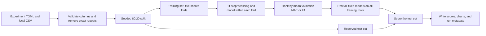
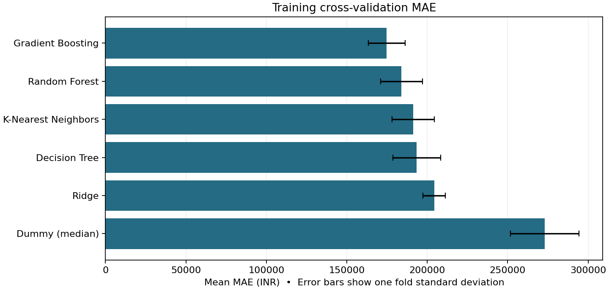
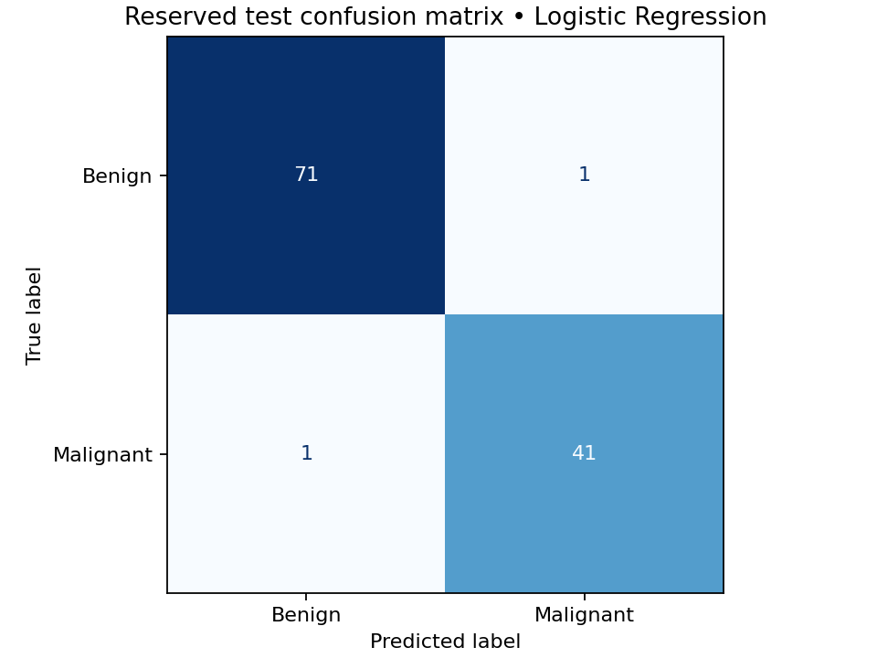

# ML Benchmark Lab

ML Benchmark Lab compares six scikit-learn models on tabular datasets using a shared, reproducible evaluation workflow. The project demonstrates how to add an experiment through configuration and how to keep preprocessing and model selection separate from final evaluation.

## Features

- One command-line runner for regression and binary classification, with a simple baseline for each task.
- Seeded train/test splits, shared cross-validation folds, and preprocessing fitted independently inside each fold.
- CSV leaderboards, per-fold scores, diagnostic charts, and metadata recording the dataset checksum, model settings, and numerical library versions.

**Stack:** Python 3.12.16, Conda, pandas, scikit-learn, Matplotlib, and pytest. Experiment settings use TOML.

## Datasets

| Dataset | Task and target | Records |
|---|---|---:|
| CarDekho Used Cars | Regression · Listed selling price in INR | 4,340 raw, 3,577 after exact repeats |
| California Housing | Regression · Census block-group median home value in units of USD 100,000 | 20,640 |
| Breast Cancer Wisconsin (Diagnostic) | Binary classification · Malignant (`0`) or benign (`1`) | 569 |

## Workflow and structure



```text
configs/                 Dataset, features, task, split, and output settings
data/                    Dataset sources and local raw files
notebooks/               CarDekho exploratory analysis
scripts/                 Dataset preparation
src/ml_benchmark/
  __main__.py             CLI and experiment setup
  datasets.py            CSV loading and validation
  preprocessing.py       Splitting, imputation, scaling, and encoding
  models.py              Fixed model settings
  benchmark.py           Cross-validation, ranking, and holdout metrics
  reporting.py           CSV, JSON, and PNG export
tests/                   Automated checks
results/published/       Reference benchmark snapshots
results/tmp/             Local reruns, ignored by Git
```

## Install and run

From the repository root, create the environment and check its interpreter:

```bash
conda env create -f environment.yml
conda activate ml-benchmark
python --version
```

For an existing environment with Python 3.12.16, activate it and run `python -m pip install -e '.[dev]'`. The supplied Conda environment sets `OMP_NUM_THREADS=1` for a consistent single-thread OpenMP budget. With an existing environment or a virtual environment, use `export OMP_NUM_THREADS=1` in Bash or Zsh, or `$env:OMP_NUM_THREADS = "1"` in PowerShell.

Prepare CarDekho by extracting the exact version 4 CSV to `data/raw/` using the [dataset guide](data/README.md#cardekho-used-cars). The California Housing fetch requires network access on its first run. The breast cancer export uses data already bundled with scikit-learn.

```bash
python scripts/fetch_california_housing.py
python scripts/prepare_breast_cancer.py

ml-benchmark configs/used_car_prices.toml --benchmark
ml-benchmark configs/california_housing.toml --benchmark
ml-benchmark configs/breast_cancer.toml --benchmark
```

Use `--prepare-data` in place of `--benchmark` to check the split and training preprocessing before fitting models. The configs write reruns to separate folders in `results/tmp/`. Both data and output paths are relative to the TOML file.

```bash
python -m pytest
python -m pip check
```

## Published results

The table shows the selected model for each v1.0.0 run. Regression predicts a number and ranks models by **lowest validation MAE**. Classification predicts a label and ranks by **highest validation F1 for malignant**. See the [full results index](results/README.md) for all models, per-fold scores, timings, and figures. The California Housing release includes aggregate results only.

| Reference experiment | Selected model | Validation mean ± fold SD | Reserved test results |
|---|---|---|---|
| [CarDekho](results/published/cardekho-benchmark/leaderboard.csv) | Gradient Boosting | MAE 174,741 ± 11,445 INR | MAE 177,503 INR · RMSE 403,601 INR · R² 0.494 |
| [California Housing](results/published/california-housing-benchmark/leaderboard.csv) | Random Forest | MAE 0.3355 ± 0.0058 | MAE 0.3290 · RMSE 0.5069 · R² 0.804 |
| [Breast Cancer Wisconsin](results/published/breast-cancer-benchmark/leaderboard.csv) | Logistic Regression | Malignant F1 0.9703 ± 0.0151 | Accuracy 0.9825 · malignant precision, recall, and F1 0.9762 each · ROC-AUC 0.9954 |

Housing errors are in units of USD 100,000. Read each experiment's raw error metrics in its own units.



CarDekho figure uses the Kaggle Vehicle dataset by Nehal Birla and collaborators under ODbL and DbCL. [Source and reproduction notice](results/published/README.md#cardekho)



Breast cancer figure uses Wolberg et al.'s UCI dataset under CC BY 4.0. [Source and license](results/published/README.md#breast-cancer-wisconsin-diagnostic)

### Reading the metrics

- **Regression.** MAE is the average absolute error. RMSE gives larger errors more weight. R² measures improvement over predicting the test-set mean for every row. It can be negative.
- **Classification.** Accuracy counts correct predictions across both classes. Precision asks how many malignant predictions were correct. Recall asks how many actual malignant cases were detected. F1 combines precision and recall. ROC-AUC measures how well malignant probabilities rank malignant cases above benign cases across thresholds.
- **Timing.** Fit and prediction times are single wall-clock measurements, including preprocessing. Prediction timing covers one batch of predictions and excludes the separate probability call for ROC-AUC. Timing varies with hardware and system load.

## Reproducibility and limitations

Each config uses seed 42 and an 80:20 split. The five training folds are fixed for every model. Classification also preserves class proportions across the split and folds. Each run records model parameters, dependency versions, the OpenMP setting, and the CSV checksum. The published benchmarks were regenerated with v1.0.0, which uses Newton-CG for Logistic Regression and one OpenMP thread. Direct dependencies are pinned. Transitive versions are resolved during installation.

- **CarDekho.** Vehicle names are excluded. After exact-row deduplication, 334 of 716 test rows still share all six model inputs with a training row. That overlap does not establish that the same vehicle or listing appears on both sides. The holdout measures performance on a mix of seen and unseen feature combinations. The full dataset was explored before benchmarking, and the target is an asking price with no confirmed sale.
- **California Housing.** The historical target is capped at USD 500,001. Random splitting can place nearby block groups on both sides of the split and overstate generalization to new areas.
- **Breast Cancer Wisconsin.** The small historical dataset and internal holdout do not establish performance across sites or patient subgroups. This educational benchmark has no clinical validation and is unsuitable for diagnosis.

Future work includes group-aware or chronological splits where identifiers are available, external validation, and timing across repeated trials.

## License and attribution

The source code is under the [MIT License](LICENSE). Datasets retain their own terms. See the [data guide](data/README.md) and [published output notices](results/published/README.md) for CarDekho, Pace and Barry's California Housing data, and Wolberg et al.'s Breast Cancer Wisconsin (Diagnostic) dataset.
